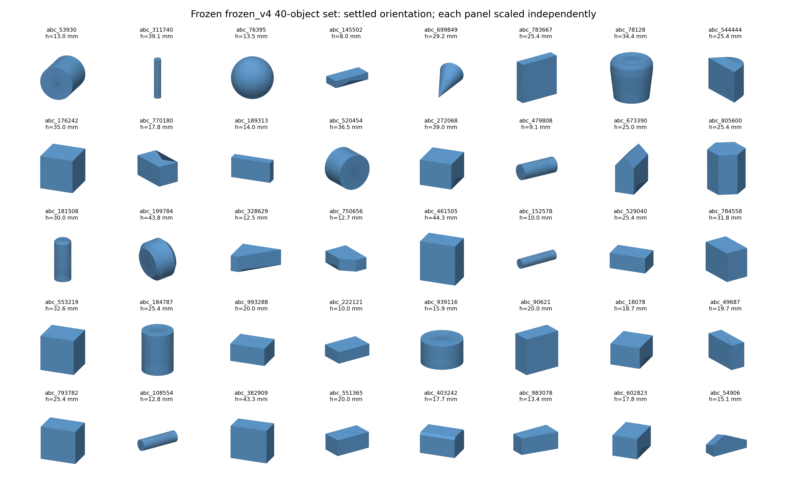

> 这是双仓库发布副本，来源报告 SHA256 `2641e33d7bdbb77f408a8d9ee49171321601d24506f2d6336f9fe8e3915521a0`。结果与源版本标签保留；链接已改为本包中的结构化证据。原始 RGB、录像与逐步轨迹按既有发布范围保存在本地，详见 [本地证据与发布范围](LOCAL_EVIDENCE.md)。本包不含独立运行所需的全部资产与原始输入。

# FingerEyeLab 三指与重抓配对评测

状态：正式80条回执已齐（含基础设施失败，完整物理证据另列）。
正式结果已返回 80/80 回合；统计单位为40个不同物体，每个物体两种视觉条件。

## 配置与分母

基线提交：`7fa3bd37752a38d5b2dc65da6735804c78057a09`。正式候选提交：`9daeff1043917ac40f518b8f80d1103d0fe63bc1`。
正式结果记录提交：`9daeff1043917ac40f518b8f80d1103d0fe63bc1`。
早期三指/恢复实现提交为`a1bbe71ae86f79ba5f5f818352a75dc3eeb50460`；其物理验收只证明该历史版本。当前正式版本取自`frozen_v4/freeze.json`，对应提交`9daeff1043917ac40f518b8f80d1103d0fe63bc1`，不能把旧版验收移标为V4验收。
V4候选在`stage5_control.py::s5_move_segment`把`s13_preload_recovery`接入已有实测速度检查，保留平移0.15 m/s与转动1.5 rad/s的守卫阈值及原始本体反馈。该变更会改变真实命令的继续/停止分支，属于新策略/动作守卫版本，不是仅改报告或几何登记；需要本版本重新回归和物理冒烟，旧提交的连续三抓轨迹只能作为历史证据。
主配置显式为 **fast + auto + 最多3次实际抓取**。120 Hz物理、20 Hz控制、30 fps普通RGB与录像；普通评测采用minimal留档，仍生成策略需要的六路FingerEye输入。
主评分为`lift30_no_drop_v1`：命令抬升至少29.5 mm，实际抬升至少28 mm，净空至少5 mm，满足末尾连续2 s的保持、无掉落及完整性门槛；名义试抬30 mm。旧严格评分单列。
实际抓次以成功下发并有物理步记录的闭合动作计；规划候选、手型选择或被守卫拒绝的命令不计。原位调预载后的重新试抬占一次物理尝试预算，并与新闭合分开标记。文中的实际两指/三指指真实执行该指组闭合；不自动等同于所有手指都已接触物体，接触证据须另查物理接触记录。

干净条件保留原视觉路径；加噪条件只在策略实际读取的六路FingerEye RGB中，以浮点数加入零均值高斯噪声，σ=3/255（8-bit尺度3灰度级），再裁剪回合法范围。相机/曝光帧/预登记种子决定噪声，同一曝光重复读取像素一致；初始俯视图不加该附加噪声。原路径的额外RGB噪声为0，两组共享其余原有传感设置、初态、物理、输入时序及动作守卫。
本轮物理执行证据来自Isaac仿真的连续动力学回合。在线策略仅使用普通RGB、本体及静态标定；仿真物体位姿和接触仅供评测及离线统计。
两种条件逐物体共用零抓取几何资格回合开始时采集的同一普通初始俯视RGB，使用前校验文件哈希、图像规格及静态相机标定。每回合新渲染俯视RGB另存策略不可读的审计位置。所选冻结输入清单：`/tmp/fingereye-success30-push-cae50/code/FingerEyeLab/outputs/three_regrasp_20261122_01/overhead_inputs_v4/manifest.json`；初始RGB、几何身份与形状差异修订分别单列。
返回完整性：已完成控制器 77/80，完整性有效 78/80，基础设施异常 3；异常仍留在相应40对象分母。完整物理证据标志：False。

## 三轮协议预跑与策略版本

| 预跑提交 | 整队作废原因 | 归档回执 | 归档位置 | 排除范围 |
| --- | --- | --- | --- | --- |
| dc15ee817f8d9fcf1fb83906a9ae986b47d51d08 | 两条件初始俯视RGB未逐像素共用 | 7 | protocol_pilot_dc15ee8 | True |
| 117244a8197c431e265d56477da3f84cc3ab814f | 同一解析圆柱的126/127侧面离散被重复计为两个物体 | 6 | /tmp/fingereye-success30-push-cae50/code/FingerEyeLab/outputs/three_regrasp_20261122_01/protocol_geometry_pilot_117244a | protocol pilot; whole cohort excluded from final80 regardless outcomes |
| 19bc1d59cea7444367810e5042f04f43b4a84442 | 精确去重仍保留近球、接近比例圆柱及近立方体，未达到预先要求的形状差异 | 2 | protocol_diversity_pilot_19bc1d5 | True |

三轮已启动队列全部排除，不挑选其余对象或有利结局拼入最终80回合。前两轮分别更正初始RGB配对与跨细分几何身份；第三轮进一步冻结几何家族差异规则。物体替换依据几何与零抓取资格，不依据抓取成败；原不利预跑对象`abc_53930`按登记优先级保留。
原始修订分别见[RGB协议](evidence/audit/protocol_amendment.json)、[精确几何去重](evidence/audit/protocol_geometry_amendment.json)与[形状差异协议](evidence/audit/protocol_diversity_amendment.json)。这些审计中的“当时策略/守卫未改”只描述对应预跑修订，不能外推到V4候选。

## 几何家族5%差异规则与五个候选

精确几何身份检查继续忽略平移、旋转和统一缩放；额外的家族差异规则用于排除几乎相同的普通形状。圆柱以解析长径比例比较，差异为两比例绝对差除以较大值；长方体比较排序并归一化的三尺寸，差异为各维相对差的最大值。差异≤5%连边，形成的连通分量只保留最早预登记顺序的一个；新候选与保留对象须超过该门槛。同组近球还须满足拟合轴比≤1.01及连续径向壳相对厚度≤1%，尺寸缩放不增加新身份。
这是一项明确的几何多样性代理，并非任意曲面的数学非同构证明；无法由基元解析的形状仍依赖登记的表面/距离谱核验。传递分组可比单对5%更保守。五个替代候选按几何来源、变换和指垫区域预检登记；下表的原生姿态静态预检不能替代实际稳定摆放资格，也不能算作物理抓取验收。

| 候选ID | 已在所选冻结清单 | 统一缩放 | 登记尺寸mm | 静态指垫预检 | 源网格SHA256 |
| --- | --- | --- | --- | --- | --- |
| abc_18078 | True | 0.4171362810 | 26.516 × 30.000 × 18.713 | True | da364d770aef6b8fc4d0677190f5fac26763dad3831e64bd51213f055cde9d85 |
| abc_49687 | True | 0.4565348411 | 30.000 × 11.596 × 19.729 | True | 081295a9528584c82c9a12f40647202fcc53933d33dd955d8468c6b4741df0d7 |
| abc_403242 | True | 0.4055768252 | 30.000 × 20.603 × 17.689 | True | 18c17a94c30f49c8e8c980de19fabe65f18bc86696b4c664b352472e59d71196 |
| abc_983078 | True | 0.3430993098 | 16.415 × 30.000 × 13.383 | True | d445efb0541b1592eee392fd12f6f1aa0f8538d982c1cea4786b589c1d223087 |
| abc_602823 | True | 0.3937007822 | 21.614 × 30.000 × 17.765 | True | 480e4cef86e38e81492b152d98c9ec92ac875f3ec27fd0d578eedd33a25733d7 |

当前提案顺序：`['abc_18078', 'abc_49687', 'abc_403242', 'abc_983078', 'abc_602823']`；提案排除的近重复ID：`['abc_111783', 'abc_166839', 'abc_814805', 'abc_639369', 'abc_826913']`。最终是否选入，以所选冻结的40对象计划及零抓取资格哈希为准；未冻结或未资格通过的候选不得自动变成正式分母。
逐对公式、分组与阈值见[几何差异分析](evidence/audit/diversity_v3_analysis.json)，五候选来源与预检见[候选提案](evidence/audit/diversity_replacement_proposal.json)。

最终原始证据QA完成且匹配所选冻结：True。80回执齐全与逐帧/物理判据核验是分别报告的条件。

## 物体筛选与冻结

当前清单登记40个不同物体、80回合；与该清单对应的零抓取几何资格已返回40/40，通过40个，全部合格：True。
在正式抓取结果产生前，按稳定摆放几何筛选，禁止按抓取成败替换物体。几何身份忽略文件名、平移、旋转和统一缩放副本。原方块/圆柱与三棱锥只作开发/诊断，不并入正式分母。
最低稳定高度8.00 mm，最高50.00 mm；可用指垫支持半径1.20 mm、最大切面下陷0.30 mm、侧面指垫到桌面净空至少2.00 mm，并要求相对的普通侧面。
当前冻结的选入规则：35 originalranks and cases unchanged; five practically nearprimitive duplicates replaced by geometry-only surveycandidates, uniform maximumextent30mm, no graspoutcomeselection; allpriorcohorts excluded in full.。几何身份核验规则：Cross-tessellation analyticprimitive identity + normalizedconvexhullspectrum1e-5; practicalnear-sphere1.01axisratio and1%continuousshell, cylinderaspect5%, boxnormalizeddimensions5%; transitivefamilycomponents retain earliestoriginalregistrationrank; arbitrarysurfaces remain unresolvedbeyond documented screening.。来源调查是按登记的尺寸、面数、侧面和几何身份规则选取样本，不宣称已经穷尽所有可抓形状，也不把不同网格细分视作不同几何。指垫半径与0.3mm切面下陷是冻结的几何代理，未经过柔顺指垫承载标定。
按当前40个ID重新统计历史实验源文件引用：25个检出历史引用，15个在已扫描范围未检出，0个未知。扫描范围：Prior source experiments reports/configurations only; a mention is exposure, not evidence of completed physics or success. Output raw physics not scanned.。未检出引用不等于从未用于调参，历史提及也不等于已有物理成功；逐对象引用位置见[历史引用审计](freeze/history_exposure.json)。
冻结文件：`/tmp/fingereye-success30-push-cae50/code/FingerEyeLab/outputs/three_regrasp_20261122_01/frozen_v4/freeze.json`；运行时清单：`/tmp/fingereye-success30-push-cae50/code/FingerEyeLab/outputs/three_regrasp_20261122_01/frozen_v4/runtime_manifest.json`；资格证据：`/tmp/fingereye-success30-push-cae50/code/FingerEyeLab/outputs/three_regrasp_20261122_01/audit/settled_qualification.json`。

几何修订：旧清单的`abc_702588`与保留对象`abc_152578`属于同一圆柱，127/126段网格细分使旧等顶点数距离谱筛查漏检。旧冻结提交为`117244a8197c431e265d56477da3f84cc3ab814f`；整批移作预跑后，登记用`abc_54906`替换rank 39，当前清单已包含替换对象：True。
替换按几何规则从原生尺寸未入选候选中确定，使用统一比例0.3149606200缩放至最大尺寸30 mm，登记尺寸为9.895 × 30.000 × 15.138 mm；统一缩放保留形状比例，不产生额外物体身份。原资产SHA256：`5b8a3e733c7ed6c5fe4323101b70a31a6a9dc0cd3a15acb5fea28ce142ab48bb`；缩放资产SHA256：`30f6890f0c6a3b95a070e7a1b78f67fb7bb48dcf91b0a6f958ed190a8d12c4fd`。替换在该对象抓取前登记，须先通过零抓取摆放和接触区域资格；选择是否使用抓取成败：False。
替换来源、变换、初态、种子及选择规则见[几何替换提案](evidence/audit/replacement_geometry_proposal.json)，整批作废范围见[几何协议修订](evidence/audit/protocol_geometry_amendment.json)，跨网格重复的具体见证见[几何交叉核验](evidence/audit/geometry_tessellation_crosscheck.json)。



全部预登记物体，按冻结顺序展示稳定摆放姿态；每格独立等比例缩放，h为几何资格检查后的实际高度，不能按画面大小比较实物尺寸。含重复形状家族，几何比例各异；不是40个语义类别。可导出的[PDF](figures/objects40.pdf)与[网格和高度来源](figures/objects40_sources.json)一并保留。

## 首抓、三抓与视觉噪声

| 条件 | 已返回 | 最终成功/固定分母 | 最终率 | 首抓成功 | 第二抓新增 | 第三抓新增 | 实际0/1/2/3抓 | 全部平均抓次 | 成功平均抓次 |
| --- | --- | --- | --- | --- | --- | --- | --- | --- | --- |
| 原视觉 | 40 | 20/40 | 50.0% | 20 | 0 | 0 | 1/27/2/10 | 1.52 | 1.00 |
| 加噪 | 40 | 21/40 | 52.5% | 21 | 0 | 0 | 0/28/2/10 | 1.55 | 1.00 |

未返回回合不会被解释为失败；进度快照中的固定分母百分比不构成完整成功率估计。80条预登记回执齐全后报告每条件40对象的整体结果；基础设施失败保留为失败并单列，未采集到的初态和图像仍标为未知，不冒充完整物理配对。

| 条件 | 规划拒绝 | 物理失败 | 设施超时 | 其他设施错误 |
| --- | --- | --- | --- | --- |
| 原视觉 | 0 | 18 | 1 | 1 |
| 加噪 | 0 | 18 | 1 | 0 |

原视觉成功→加噪失败：无已确认配对。
原视觉失败→加噪成功：abc_189313。
初态不一致对象：无已确认不一致；初始俯视RGB不一致对象：无已确认不一致。未能采集初始图的对象：abc_189313；缺失保留为未知，不记为已核对相同。

对象层面的Wilson95%区间（每条件n=40；不是把80回合当成80个独立对象）：

| 条件 | 首抓率95%CI | 最终率95%CI |
| --- | --- | --- |
| 原视觉 | 35.2–64.8% | 35.2–64.8% |
| 加噪 | 37.5–67.1% | 37.5–67.1% |

噪声配对不一致计数b=0, c=1；双侧exact McNemar p=1。每对象只有一个预登记种子，区间和检验描述本协议下的有限样本，不能证明对任意噪声或初态泛化。

## 实际选指和恢复

原视觉：

| 统计 | 两指 | 三指 |
| --- | --- | --- |
| 首抓实际物体数 | 39 | 0 |
| 全部实际尝试数 | 61 | 0 |
| 最终成功实际指组 | 20 | 0 |

auto可行性选择范围：`{"only_one_group_feasible": 78, "no_feasible_group": 2}`。
真实连续转换：`{"2->2": 22, "2->3": 0, "3->2": 0, "3->3": 0}`；大幅手势变化7次，换指组0次，两者重叠0次，缺失差值证据0次。

| 恢复分支 | 考虑 | 选择 | 动作执行 | 最后救回 | 守卫拒绝 | 有条件后备 |
| --- | --- | --- | --- | --- | --- | --- |
| preload | 26 | 0 | 0 | 0 | 0 | 0 |
| local_pose | 26 | 32 | 15 | 0 | 17 | 0 |
| release_resample | 26 | 0 | 7 | 0 | 4 | 26 |

加噪：

| 统计 | 两指 | 三指 |
| --- | --- | --- |
| 首抓实际物体数 | 40 | 0 |
| 全部实际尝试数 | 62 | 0 |
| 最终成功实际指组 | 21 | 0 |

auto可行性选择范围：`{"only_one_group_feasible": 81, "no_feasible_group": 4}`。
真实连续转换：`{"2->2": 22, "2->3": 0, "3->2": 0, "3->3": 0}`；大幅手势变化8次，换指组0次，两者重叠0次，缺失差值证据0次。

| 恢复分支 | 考虑 | 选择 | 动作执行 | 最后救回 | 守卫拒绝 | 有条件后备 |
| --- | --- | --- | --- | --- | --- | --- |
| preload | 26 | 0 | 0 | 0 | 0 | 0 |
| local_pose | 26 | 32 | 14 | 0 | 18 | 0 |
| release_resample | 26 | 0 | 8 | 0 | 4 | 26 |

auto搜索与实际下发的独立审计：

| 条件 | 选择调用 | 两组均有记录 | 两组均通过全部检查 | 实际闭合 | 缺少下发回执 |
| --- | --- | --- | --- | --- | --- |
| 原视觉 | 80 | 46 | 0 | 61 | 0 |
| 加噪 | 85 | 48 | 0 | 62 | 0 |

局部细化调用可能只搜索当前指组，故`only_one_group_feasible`不能单独证明另一组也被搜索后拒绝。只有`both_groups_logged=true`的调用能支持这一判断；两组均可行时的分数、排序、选中候选与实际下发回执分别在[选择表](selection/events.csv)和[实际下发表](selection/actual_dispatches.csv)中绑定。

| 条件 | 指组 | 记录候选 | IK独立通过 | IK后端点通过 | 完整路径通过 | 路径拒绝 | 路径未评估 |
| --- | --- | --- | --- | --- | --- | --- | --- |
| 原视觉 | 2 | 126 | 126 | 126 | 124 | 2 | 0 |
| 原视觉 | 3 | 1650 | 87 | 0 | 0 | 0 | 1650 |
| 加噪 | 2 | 133 | 133 | 133 | 129 | 4 | 0 |
| 加噪 | 3 | 1722 | 87 | 0 | 0 | 0 | 1722 |

该表计数单位为候选/搜索调用，不能作对象成功数。端点诊断可能在更早IK失败后仍被计算；“IK后端点通过”要求前置检查也通过。未到达路径检查不等于路径已失败。逐对象、逐调用原始计数与首个拒绝条件见[分层门控表](selection/candidate_gate_counts.csv)，连杆/间隙/阈值及关节见[完整选择审计](selection/audit.json)。

真实接触离线核对：

| 条件 | 实际尝试 | 尝试内采样到承载手指 | 末尾2秒承载手指 | 成功尝试承载手指 |
| --- | --- | --- | --- | --- |
| 原视觉 | 61 | {"index+thumb": 37, "none_sampled": 18, "index": 3, "thumb": 3} | {"none_sampled": 30, "index+thumb": 29, "index": 2} | {"index+thumb": 20} |
| 加噪 | 62 | {"index+thumb": 38, "none_sampled": 17, "index": 4, "thumb": 3} | {"none_sampled": 30, "index+thumb": 31, "index": 1} | {"index+thumb": 21} |

承载接触定义为仿真法向力>1e−6 N，按6个物理步即0.05 s采样，仅离线使用。近邻碰撞对和下发指组均不能替代承载证据；未采到接触不能证明采样间隔内绝无接触。每次尝试在真实恢复命令前截断，末尾2 s另列；逐例力、连杆和源文件哈希见[接触审计](contacts/audit.json)与[逐次接触CSV](contacts/attempts.csv)。

| 恢复分支 | 考虑 | 选择 | 动作执行 | 最后救回 | 守卫拒绝 | 有条件后备 |
| --- | --- | --- | --- | --- | --- | --- |
| preload | 52 | 0 | 0 | 0 | 0 | 0 |
| local_pose | 52 | 64 | 29 | 0 | 35 | 0 |
| release_resample | 52 | 0 | 15 | 0 | 8 | 52 |

分支选择、恢复动作执行、下一次实际抓取与最终救回是不同事件；“执行释放/退让”本身不表示已经闭合。最后救回由物理评分离线核算，不能用视觉支持判断代替。
大幅手势改变预先定义为同一预闭合阶段的物体相对腕姿变化≥30°，或共同手指实际指垫平均落点移动≥5 mm。原始弧度/米差值及与换指组的重叠保存在`transitions.csv`；该统计允许离线使用物体位姿。

## 时间（秒）

各单元格为平均/中位数/P90；P90采用相邻次序统计量的线性插值。物理时间按120 Hz实际步数计算，墙钟包含仿真启动、计算、渲染、日志及结束处理。

| 时间类型 | 原视觉 平均/中位/P90 | 加噪 平均/中位/P90 |
| --- | --- | --- |
| 机器人动作物理时间 | 40.76/30.80/67.35 | 40.88/30.70/75.18 |
| 首抓物理阶段 | 27.93/28.77/30.76 | 27.91/28.75/30.74 |
| 恢复与再抓额外物理时间 | 12.83/0.00/45.67 | 12.97/0.00/52.93 |
| 已记录命令间策略墙钟子集 | 45.41/36.50/84.70 | 46.32/36.25/84.30 |
| 端到端墙钟 | 162.97/129.50/285.71 | 169.05/134.03/285.50 |

| 时间样本 | 原视觉 | 加噪 |
| --- | --- | --- |
| 完整物理/策略时间 | 38 | 39 |
| 精确端到端墙钟 | 38 | 39 |
| 入口墙钟缺失或中断 | 0 | 0 |

启动异常前只记录到的物理时间是该中断回合的已观察值，逐例保留但不冒充完成回合耗时。若恢复的调度回执缺少精确入口墙钟，仅从入口墙钟统计中排除；完整物理步与策略单调时钟仍计入其各自统计。缺失数量以当前逐例标志和上表为准。旧`117244a`预跑的两份回执恢复和串行回退分别记录在[audit/formal80_recovered_receipts.json](evidence/audit/formal80_recovered_receipts.json)与[串行回退](evidence/audit/formal80_serial_fallback.json)，不并入当前正式统计。

策略计算字段来自审计记录；命令RPC墙钟、渲染和物理执行另计。若记录只覆盖命令间计算，不能将其解释为全部CPU求解时间。精细分段及原始相位统计见逐例JSON的`phase_wall_components`、`phase_physical_s`和`wall_profile`。

| 全部回执的已观察时间 | 原视觉 n；平均/中位/P90 | 加噪 n；平均/中位/P90 |
| --- | --- | --- |
| 已记录物理秒（含设施中断；中断值可能仅为下界） | 40；39.81/30.80/62.35 | 40；40.94/30.80/74.49 |
| 可用精确端到端墙钟（含设施失败） | 40；192.70/129.50/289.11 | 40；202.45/134.51/313.47 |
| 设施失败的已观察端到端墙钟 | 2；757.57/757.57/1355.56 | 1；1505.05/1505.05/1505.05 |

上一主时间表使用完成回合；此表补齐全部回执中可用的实际耗时。缺失精确墙钟的回执保留在成败与抓次分母，时间统计明确列出样本量。

| 实际相位 | 原视觉物理秒 平均/中位/P90 | 加噪物理秒 平均/中位/P90 |
| --- | --- | --- |
| s13_local_reposition | 0.14/0.00/0.80 | 0.12/0.00/0.48 |
| s13_recovery_observe | 0.13/0.00/0.40 | 0.12/0.00/0.40 |
| s3_lower | 1.76/0.00/5.20 | 1.71/0.00/5.20 |
| s3_open | 0.98/0.00/2.64 | 0.99/0.00/3.20 |
| s3_retreat | 0.29/0.00/1.20 | 0.32/0.00/1.20 |
| s3_settle | 0.29/0.00/1.20 | 0.32/0.00/1.20 |
| s5_close | 0.45/0.30/0.83 | 0.44/0.30/0.82 |
| s5_close_observe | 0.31/0.20/0.60 | 0.31/0.20/0.60 |
| s5_descend | 3.30/2.70/5.49 | 3.36/2.70/5.70 |
| s5_hold | 3.53/3.40/3.92 | 3.51/3.40/3.88 |
| s5_lift | 5.27/5.00/5.00 | 5.26/5.00/5.00 |
| s5_orient | 6.37/4.60/13.64 | 6.56/4.80/13.56 |
| s5_park | 0.24/0.20/0.40 | 0.24/0.20/0.40 |
| s5_preload_adjust | 3.56/2.60/7.80 | 3.50/2.60/7.80 |
| s5_preload_hold | 3.97/2.65/8.14 | 3.95/2.70/7.98 |
| s5_proof | 2.98/2.00/5.97 | 2.94/2.00/5.92 |
| s5_raise | 1.56/1.00/4.00 | 1.63/1.00/4.04 |
| s5_reobserve | 1.11/2.00/2.00 | 0.97/0.00/2.00 |
| s5_rgb_realign | 1.68/2.00/2.00 | 1.69/2.00/2.00 |
| s5_translate | 2.86/2.40/4.86 | 2.92/2.40/5.00 |

包含首次规划的策略侧墙钟补充（排除全部后端RPC服务区间）：

| 范围 | 原视觉 平均/中位/P90 | 加噪 平均/中位/P90 |
| --- | --- | --- |
| 全部策略侧非RPC墙钟 | 51.42/40.61/97.16 | 52.29/40.14/95.61 |
| 首次物理动作前策略侧墙钟 | 32.39/32.68/36.25 | 32.57/33.06/36.59 |
| 后端RPC服务墙钟 | 84.11/61.71/160.50 | 89.48/66.70/168.06 |

补充使用同一后端单调时钟的ready→finish时间跨度减去所有RPC服务区间的并集，包含首次规划、策略进程调度及IPC空闲，不能称为进程纯CPU时间；逐例数值、范围和源文件SHA256见`timing_audit.json`。

分阶段可加和核对：76/80回合时间完整。缺失时间仅从时间汇总中排除，绝不移出成败分母。

| 阶段 | 量 | 原视觉 平均/中位/P90 | 加噪 平均/中位/P90 |
| --- | --- | --- | --- |
| 首次规划 | 物理秒 | 0.00/0.00/0.00 | 0.00/0.00/0.00 |
| 首次规划 | 策略侧非RPC墙钟 | 32.39/32.68/36.25 | 32.41/33.05/36.46 |
| 首次规划 | 后端跨度墙钟 | 32.39/32.68/36.25 | 32.41/33.05/36.46 |
| 首抓至首次恢复前 | 物理秒 | 27.93/28.77/30.76 | 27.88/28.75/30.76 |
| 首抓至首次恢复前 | 策略侧非RPC墙钟 | 5.92/6.40/6.90 | 5.91/6.39/6.90 |
| 首抓至首次恢复前 | 后端跨度墙钟 | 63.06/60.13/71.55 | 64.69/62.65/74.08 |
| 释放与退让 | 物理秒 | 3.33/0.00/10.00 | 3.43/0.00/10.00 |
| 释放与退让 | 策略侧非RPC墙钟 | 0.00/0.00/0.00 | 0.00/0.00/0.00 |
| 释放与退让 | 后端跨度墙钟 | 8.08/0.00/22.31 | 9.47/0.00/24.70 |
| 恢复后观察与再规划 | 物理秒 | 0.00/0.00/0.00 | 0.00/0.00/0.00 |
| 恢复后观察与再规划 | 策略侧非RPC墙钟 | 13.11/0.00/60.90 | 14.14/0.00/60.74 |
| 恢复后观察与再规划 | 后端跨度墙钟 | 13.11/0.00/60.90 | 14.14/0.00/60.75 |
| 恢复动作与再抓 | 物理秒 | 9.51/0.00/39.86 | 9.88/0.00/42.48 |
| 恢复动作与再抓 | 策略侧非RPC墙钟 | 0.00/0.00/0.00 | 0.00/0.00/0.00 |
| 恢复动作与再抓 | 后端跨度墙钟 | 18.90/0.00/92.87 | 21.77/0.00/92.42 |

首次规划含首次观察及IK；首抓阶段含入场、闭合及试抬验证。首次实际恢复动作后的释放/退让按记录相位分类；之后全部非RPC空隙和纯观察请求归入再规划，其余物理动作归入再抓（含局部动作/预载复验）。五阶段墙钟严格加和为后端ready→finish；另加启动/结束残差才是端到端墙钟。这是墙钟归因而非进程纯CPU时间；并发调度、IPC等待也计入。详见[分段定义和汇总](timing/TIMING.md)、[逐例CSV](timing/stages.csv)和[加和核对JSON](timing/audit.json)。

## 40对象完整配对表

| 对象ID | 原视觉：结局/真实抓次/指组序列 | 加噪：结局/真实抓次/指组序列 | 初态噪声种子 |
| --- | --- | --- | --- |
| abc_53930 | physical_failure; 3抓; 2→2→2指 | physical_failure; 3抓; 2→2→2指 | 13000 |
| abc_311740 | 成功; 1抓; 2指 | 成功; 1抓; 2指 | 13001 |
| abc_76395 | infrastructure_timeout; 3抓; 2→2→2指 | infrastructure_timeout; 3抓; 2→2→2指 | 13002 |
| abc_145502 | physical_failure; 3抓; 2→2→2指 | physical_failure; 3抓; 2→2→2指 | 13003 |
| abc_699849 | physical_failure; 1抓; 2指 | physical_failure; 1抓; 2指 | 13004 |
| abc_783667 | 成功; 1抓; 2指 | 成功; 1抓; 2指 | 13005 |
| abc_78128 | physical_failure; 1抓; 2指 | physical_failure; 1抓; 2指 | 13006 |
| abc_544444 | physical_failure; 3抓; 2→2→2指 | physical_failure; 3抓; 2→2→2指 | 13007 |
| abc_176242 | physical_failure; 1抓; 2指 | physical_failure; 1抓; 2指 | 13008 |
| abc_770180 | 成功; 1抓; 2指 | 成功; 1抓; 2指 | 13009 |
| abc_189313 | infrastructure_error; 0抓; 0指 | 成功; 1抓; 2指 | 13010 |
| abc_520454 | 成功; 1抓; 2指 | 成功; 1抓; 2指 | 13011 |
| abc_272068 | physical_failure; 1抓; 2指 | physical_failure; 1抓; 2指 | 13012 |
| abc_479808 | physical_failure; 3抓; 2→2→2指 | physical_failure; 3抓; 2→2→2指 | 13013 |
| abc_673390 | 成功; 1抓; 2指 | 成功; 1抓; 2指 | 13014 |
| abc_805600 | physical_failure; 1抓; 2指 | physical_failure; 1抓; 2指 | 13015 |
| abc_181508 | physical_failure; 2抓; 2→2指 | physical_failure; 2抓; 2→2指 | 13016 |
| abc_199784 | physical_failure; 1抓; 2指 | physical_failure; 1抓; 2指 | 13017 |
| abc_328629 | physical_failure; 3抓; 2→2→2指 | physical_failure; 3抓; 2→2→2指 | 13018 |
| abc_750656 | 成功; 1抓; 2指 | 成功; 1抓; 2指 | 13019 |
| abc_461505 | 成功; 1抓; 2指 | 成功; 1抓; 2指 | 13020 |
| abc_152578 | physical_failure; 3抓; 2→2→2指 | physical_failure; 3抓; 2→2→2指 | 13021 |
| abc_529040 | 成功; 1抓; 2指 | 成功; 1抓; 2指 | 13022 |
| abc_784558 | 成功; 1抓; 2指 | 成功; 1抓; 2指 | 13023 |
| abc_553219 | physical_failure; 1抓; 2指 | physical_failure; 1抓; 2指 | 13024 |
| abc_184787 | 成功; 1抓; 2指 | 成功; 1抓; 2指 | 13025 |
| abc_993288 | 成功; 1抓; 2指 | 成功; 1抓; 2指 | 13026 |
| abc_222121 | physical_failure; 3抓; 2→2→2指 | physical_failure; 3抓; 2→2→2指 | 13027 |
| abc_939116 | 成功; 1抓; 2指 | 成功; 1抓; 2指 | 13028 |
| abc_90621 | 成功; 1抓; 2指 | 成功; 1抓; 2指 | 13029 |
| abc_18078 | physical_failure; 3抓; 2→2→2指 | physical_failure; 3抓; 2→2→2指 | 13030 |
| abc_49687 | 成功; 1抓; 2指 | 成功; 1抓; 2指 | 13031 |
| abc_793782 | 成功; 1抓; 2指 | 成功; 1抓; 2指 | 13032 |
| abc_108554 | physical_failure; 3抓; 2→2→2指 | physical_failure; 3抓; 2→2→2指 | 13033 |
| abc_382909 | 成功; 1抓; 2指 | 成功; 1抓; 2指 | 13034 |
| abc_551365 | 成功; 1抓; 2指 | 成功; 1抓; 2指 | 13035 |
| abc_403242 | 成功; 1抓; 2指 | 成功; 1抓; 2指 | 13036 |
| abc_983078 | 成功; 1抓; 2指 | 成功; 1抓; 2指 | 13037 |
| abc_602823 | 成功; 1抓; 2指 | 成功; 1抓; 2指 | 13038 |
| abc_54906 | physical_failure; 2抓; 2→2指 | physical_failure; 2抓; 2→2指 | 13039 |

## 历史同初态开发对照（不进正式分母）

| 版本 | 案例 | 结果提交 | 成功 | 实际抓次 | 实际指组序列 | 物理秒 | 墙钟秒 |
| --- | --- | --- | --- | --- | --- | --- | --- |
| 基线7fa3bd3 | cube_auto | 7fa3bd37752a38d5b2dc65da6735804c78057a09 | True | 1 | 2 | 28.70 | 106.27 |
| 基线7fa3bd3 | cube_three | 7fa3bd37752a38d5b2dc65da6735804c78057a09 | False | 0 | 0 | 0.00 | 39.77 |
| 基线7fa3bd3 | cube_two | 7fa3bd37752a38d5b2dc65da6735804c78057a09 | True | 1 | 2 | 28.70 | 98.66 |
| 基线7fa3bd3 | cylinder_auto | 7fa3bd37752a38d5b2dc65da6735804c78057a09 | True | 1 | 2 | 24.90 | 93.25 |
| 基线7fa3bd3 | cylinder_three | 7fa3bd37752a38d5b2dc65da6735804c78057a09 | False | 0 | 0 | 0.00 | 37.76 |
| 基线7fa3bd3 | cylinder_two | 7fa3bd37752a38d5b2dc65da6735804c78057a09 | True | 1 | 2 | 24.90 | 86.78 |
| 基线7fa3bd3 | pyramid_auto3 | 7fa3bd37752a38d5b2dc65da6735804c78057a09 | False | 1 | 2 | 21.80 | 115.87 |
| 历史候选a1bbe71 | cube_auto | a1bbe71ae86f79ba5f5f818352a75dc3eeb50460 | False | 1 | 2 | 28.90 | 122.58 |
| 历史候选a1bbe71 | cube_three | a1bbe71ae86f79ba5f5f818352a75dc3eeb50460 | False | 0 | 0 | 0.00 | 51.91 |
| 历史候选a1bbe71 | cube_two | a1bbe71ae86f79ba5f5f818352a75dc3eeb50460 | True | 1 | 2 | 28.70 | 93.34 |
| 历史候选a1bbe71 | cylinder_auto | a1bbe71ae86f79ba5f5f818352a75dc3eeb50460 | True | 1 | 2 | 25.10 | 112.85 |
| 历史候选a1bbe71 | cylinder_three | a1bbe71ae86f79ba5f5f818352a75dc3eeb50460 | False | 0 | 0 | 0.00 | 53.86 |
| 历史候选a1bbe71 | cylinder_two | a1bbe71ae86f79ba5f5f818352a75dc3eeb50460 | True | 1 | 2 | 24.90 | 82.97 |
| 历史候选a1bbe71 | pyramid_auto3 | a1bbe71ae86f79ba5f5f818352a75dc3eeb50460 | False | 3 | 2/2/2 | 75.60 | 309.30 |

固定三指没有实际闭合的案例属于规划拒绝，不能算作三指物理能力验证。若auto只有两指可行，选择两指不证明两种可行手型之间的优劣。这些物理小样本只属于表中旧提交，不能验收新增实测速度守卫的V4，也不能替代40对象统计。

## 新增预载速度守卫的独立物理验收

以下仅读取`guard_acceptance_readout/`的新版本记录，全部排除于正式80回合。固定三指若实际0抓仍如实记为规划拒绝，不能把完成一个仿真回合解释为三指闭合成功。缺失记录保留“未运行”，不借用a1bbe71或任一作废队列。

| 验收案例 | 实际源提交 | 成功 | 实际抓次 | 实际指组 | 其中预载复验 | 控制器完成 | 源提交同最终冻结 |
| --- | --- | --- | --- | --- | --- | --- | --- |
| cube_two | 882486475ae25462ced8ac11d3da1aa45ea3d367 | True | 1 | 2 | 0 | True | False |
| cube_three | 882486475ae25462ced8ac11d3da1aa45ea3d367 | False | 0 | 0 | 0 | True | False |
| cube_auto | 882486475ae25462ced8ac11d3da1aa45ea3d367 | False | 1 | 2 | 0 | True | False |
| pyramid_auto3 | 882486475ae25462ced8ac11d3da1aa45ea3d367 | False | 3 | 2→2→2 | 0 | True | False |

尚缺验收记录：`[]`。验收提交与最终冻结若不同，需按各自提交及运行时哈希解释，不自动宣称相同策略。真实守卫停止、物理阶段与后续回执在对应逐例JSON及启动记录中核对；没有后续ack不抹去已有motor-phase执行。

自动选指逐例原因：

| 版本 | 案例 | 决策步 | 选中指组 | 可行性范围 | 实际抓次 | 下发指组 |
| --- | --- | --- | --- | --- | --- | --- |
| 基线7fa3bd3 | cube_auto | 0 | 2 | only_one_group_feasible | 1 | 2 |
| 基线7fa3bd3 | cylinder_auto | 0 | 2 | only_one_group_feasible | 1 | 2 |
| 历史候选a1bbe71 | cube_auto | 0 | 2 | only_one_group_feasible | 1 | 2 |
| 历史候选a1bbe71 | cylinder_auto | 0 | 2 | only_one_group_feasible | 1 | 2 |

同负载离线任务比较（假设模型，非实测力）：

| 指组 | 几何可行 | 名义任务裕量 | 不确定性任务裕量 | 不确定性任务可行 | 名义侧扰裕量 | 名义力矩裕量 | 质量假设kg | 运动成本范围 |
| --- | --- | --- | --- | --- | --- | --- | --- | --- |
| 2 | True | 3.42 | 0.32 | False | 5.69 | 3.42 | [0.005, 0.015] | two: production path available; three: refused endpoint, motion cost unavailable |
| 3 | False | 0.00 | 0.00 | False | 0.00 | 0.00 | [0.005, 0.015] | two: production path available; three: refused endpoint, motion cost unavailable |

共同假设：质量[0.005, 0.015] kg、摩擦下界0.3、每指法向力上限1.0 N、抬升加速度[0.0, 0.0, 0.5] m/s²、水平扰动0.02 N、力矩扰动0.0001 N·m。
三指未通过几何时，其理论抗扰裕量不能转为可执行方案优势；两指名义裕量超过1也不代表不确定性任务裕量超过1。质量、摩擦、力限、平面接触足迹和扰动是公开假设，不能称作测得的托重能力。完整模型、运动成本范围和约束见[audit/same_load_two_three.json](evidence/audit/same_load_two_three.json)。

## 可复核的计算链

历史三指拒绝案例：基线`cube_three`，提交`7fa3bd3`。`visual_controller.py::_s12_rgb_contact_regions`从公开RGB包络生成区域，`_s12_region_ik`与`Robot.ik`先后求区域/固定落点IK，`_s12_complete_candidate`执行逐指位置、法向、关节限位和端点检查；`SelfAwareGeometry.check`首次拒绝，因此接近/闭合/抬升路径不会下发。候选任务评分调用`stage5_control.py::s12_task_quality`与`general_grasp_contacts.py::friction_wrench_feasibility`，先可行性门控，再按同一负载及扰动假设比较力/力矩裕量、间隙与运动代价。
原候选逐指位置误差（mm）：`[0.04109, 0.20909, 0.21058]`；法向误差（rad）：`[0.31244882542310726, 0.10084672633563534, 0.16353268585007052]`。
首个具体失败：`self_collision`；连杆`['left_hand_index_camera_component3_link', 'left_hand_middle_link2']`；间隙-0.10556 mm，阈值0.00000 mm。机器人自身碰撞和RGB包络碰撞分别保存在`audit/baseline_cube_first_rejection.json`，带原关节、落点、阈值与哈希。
位置门槛为逐指0.8 mm、法向门槛0.5 rad，原候选均通过；桌面最小净空2.99968 mm也通过0.65 mm门槛。其后首先拒绝食指相机component3壳与中指link2的0.10556 mm重叠；另有中指相机component1/component3及link2与RGB包络约6.02615/3.59163/4.57084 mm重叠。自身碰撞与物体包络碰撞为独立检查，不能用其中一项替代另一项。
机器人自身几何碰撞具有独立拒绝证据；即使离线真值表明RGB包络过大，也不能据此忽略自身碰撞。该审计复用记录的关节和公开RGB，用当前等价守卫补充有符号见证；不是一次新的物理执行。

三指搜索把腕部侧倾、食指/中指高度差、指间距与接触面作为区域布局/初值变量；区域IK和固定落点IK都带净空残差，第二次IK后重新检查全部端点与路径。保留的三指方块/圆柱开发结果仍全部拒绝，没有为达到三指执行目标放宽原守卫。每次搜索实际枚举的布局、腕部初值、逐指高度与角向偏移、42 s搜索预算及首个拒绝条件保存在候选JSON；有界搜索失败不能证明全空间无三指解。详细数据、函数和中间命令见[计算链说明](chains/COMPUTATION_CHAINS.md)。

| 三指开发案例 | 记录候选 | 布局数 | 腕部初值编号 | 表面高度比例范围 | 角向偏移范围rad | 第二次IK后的腕部ZYX角范围rad |
| --- | --- | --- | --- | --- | --- | --- |
| cube_three | 36 | 12 | [0, 1, 2] | 0.20–0.85 | -1.25–1.25 | yaw=[-2.355,3.351]; pitch=[0.450,1.250]; roll=[-2.440,3.077] |
| cylinder_three | 36 | 12 | [0, 1, 2] | 0.20–0.85 | -1.25–1.25 | yaw=[-2.016,3.137]; pitch=[0.555,1.205]; roll=[-2.101,2.898] |

初值0沿用公开几何配准；初值1在配准后ZYX角上加[0.50,−0.45,0.35] rad并改变指关节；初值2用三指静态法向与RGB目标法向做刚体配准。表中腕角是实际记录的优化终点范围，不能解释为连续穷举。两个开发案例记录的表面主轴均为[1,0,0]，12布局×3初值共36候选；恢复后可重采主轴，但本表不声称已覆盖所有方向。

历史实际重抓案例：开发诊断`pyramid_auto3`，提交`a1bbe71`，同一连续物理回合，最多三抓。`stage13_recovery.py::policy_main`由`s13_evaluate`判断公开失败证据，依次调用`s13_preload`及`s13_release_recover`，后者经`visual_controller.py::stage3_recover`尝试`s13_local_probe`。`s13_legal_start`保留原实测q，生成合法命令种子并验证连接；新图证据不足时不强行调预载，局部候选不可行则继续完整释放、退开、重新观察和采样。最终`s5_close`经`s5_step`调用`ctx.step`，并在成功派发后写`grasp_dispatched`。

| 事件 | 物理步 | 分支 | 闭合起始步/判定 |
| --- | --- | --- | --- |
| grasp_dispatched | 1326 | initial | 1320 |
| failure_decision | 2160 | — | observed_failure |
| selected | 2184 | release_resample | — |
| selected | 2280 | local_pose | — |
| guard_refused | 2280 | planning | actual_to_legal_connection |
| selected | 2328 | local_pose | — |
| guard_refused | 2328 | planning | actual_to_legal_connection |
| executed | 2664 | release_resample | — |
| grasp_dispatched | 4782 | release_resample | 4776 |
| failure_decision | 5616 | — | observed_failure |
| selected | 5640 | release_resample | — |
| executed | 6120 | release_resample | — |
| grasp_dispatched | 8238 | release_resample | 8232 |
| failure_decision | 9072 | — | physical_attempt_limit |

物理轨迹核对的实际闭合起始步：`[1320, 4776, 8232]`。其最终成功为`False`，因此该案例证明第二/第三次闭合真正下发，不证明重抓救回。实际目标q、反馈q、候选ID与规划哈希在逐例JSON和`agent_trace.jsonl`中绑定；`steps.jsonl`提供120 Hz物理执行记录。

## 旧严格评分附表

| 条件 | lift30_no_drop_v1成功 | 旧严格成功 |
| --- | --- | --- |
| 原视觉 | 20 | 18 |
| 加噪 | 21 | 19 |

## 视频、复跑和证据

视频复跑不进入正式分母，需保留原配置、种子和提交，并核对抓次、实际指组与结局。复跑核对清单及4–6段代表视频由`videos/manifest.json`登记；未登记视频不视作已交付。

- [precheck_cube_two_success](LOCAL_EVIDENCE.md)：入口预检：固定两指，首抓成功；提交a1bbe71；原始物理运行，非正式分母；复跑=False；核对=True。
- [precheck_cube_auto_failure](LOCAL_EVIDENCE.md)：入口预检：auto实际两指，实际抬升约25.7mm未过28mm门槛；原始运行；复跑=False；核对=True。
- [diagnostic_pyramid_regrasp](LOCAL_EVIDENCE.md)：诊断组：同一回合真实三次闭合，2→2→2，两次完整释放重采样，未救回；原始运行，不入正式分母；复跑=False；核对=True。
- [final_pair_clean](LOCAL_EVIDENCE.md)：冻结v4 9daeff1：同初态abc_311740，原视觉；独立录像复跑，不增加正式分母；复跑=True；核对=True。
- [final_pair_noise](LOCAL_EVIDENCE.md)：冻结V4 9daeff1：abc_311740加噪配对录像；原录像启动失败后独立复跑，不计正式分母；复跑=True；核对=True。
- [final_recovery_or_three](LOCAL_EVIDENCE.md)：冻结V4 9daeff1：真实局部重抓代表；独立录像复跑，不增加正式分母；复跑=True；核对=True。

核心数据：[80回合CSV](results/episodes.csv)、[总汇JSON](results/SUMMARY.json)、[真实重抓转换表](results/transitions.csv)、[冻结清单](freeze/freeze.json)、[预登记40物体与80回合计划](freeze/plan.json)、[资格审计](freeze/settled_qualification.json)、[正式输入与判据核验](qa/final80_validation.json)、[历史引用审计](freeze/history_exposure.json)、[视频索引](LOCAL_EVIDENCE.md)、[复核与复跑说明](REPRODUCE.md)。逐例JSON在`publication_readout/`；实际启动命令、环境与提交在各回合`launch.json`中。旧俯视差异和跨网格重复见证仅用于说明对应批次整批作废的原因，见[audit/initial_overhead_pair_check.json](evidence/audit/initial_overhead_pair_check.json)与[audit/geometry_tessellation_crosscheck.json](evidence/audit/geometry_tessellation_crosscheck.json)。

每例`launch.json`保存精确命令、配置和环境；`batch_result.json`、`compact.json`逐例落盘用于断点续跑。以下为冻结版本复跑入口，实际路径以冻结文件和launch记录为准：

```bash
cd /tmp/fingereye-success30-push-cae50/code/FingerEyeLab
/home/CNS2025331827/miniconda3/envs/isaaclab/bin/python /tmp/fingereye-success30-push-cae50/code/FingerEyeLab/experiments/rax_dexbin_tinyobj/stage13_batch.py --root /tmp/fingereye-success30-push-cae50/code/FingerEyeLab/outputs/three_regrasp_20261122_01/formal_runs --plan /tmp/fingereye-success30-push-cae50/code/FingerEyeLab/outputs/three_regrasp_20261122_01/frozen_v4/plan.json --controller /tmp/fingereye-success30-push-cae50/code/FingerEyeLab/outputs/three_regrasp_20261122_01/frozen_v4/submitted.py --concurrency 1 --recording-mode minimal --resume
/home/CNS2025331827/miniconda3/envs/isaaclab/bin/python experiments/rax_dexbin_tinyobj/stage13_readout.py --root /tmp/fingereye-success30-push-cae50/code/FingerEyeLab/outputs/three_regrasp_20261122_01/formal_runs --output /tmp/fingereye-success30-push-cae50/code/FingerEyeLab/outputs/three_regrasp_20261122_01/formal_readout
/home/CNS2025331827/miniconda3/envs/isaaclab/bin/python experiments/rax_dexbin_tinyobj/stage13_report.py --root /tmp/fingereye-success30-push-cae50/code/FingerEyeLab/outputs/three_regrasp_20261122_01 --readout /tmp/fingereye-success30-push-cae50/code/FingerEyeLab/outputs/three_regrasp_20261122_01/publication_readout --freeze /tmp/fingereye-success30-push-cae50/code/FingerEyeLab/outputs/three_regrasp_20261122_01/frozen_v4 --output /tmp/fingereye-success30-push-cae50/code/FingerEyeLab/outputs/three_regrasp_20261122_01/EVALUATION.md
```

普通运行默认串行，最多两路；实际并发设置以当前正式批次contract、启动审计和每例launch为准。旧`117244a`几何预跑在两路启动时出现一例原生仿真异常，随后回退串行；该异常记录包含文件监视器errno28和原生std::system_error，根因尚未确定，不能据此声称磁盘已满。该旧异常不充当当前冻结版本的基础设施失败。并发与共享主机调度影响墙钟，时间值描述本次仿真环境。原始帧和冗余日志只在报告、哈希、逐例记录及引用视频核验后清理，关键计算链所需最小轨迹保留；清理清单另存，禁止先清理再声称证据完整。

## 论文基线判断

原视觉首抓20/40，三抓最终20/40；加噪首抓21/40，三抓最终21/40。三抓相对首抓新增分别为0和0个对象；噪声后的最终成功数变化为+1/40。
正式实际三指尝试0次，重抓救回0回合。本结果应称为两指抓取基线；auto评估过三指候选，但证据未支持三指执行能力或换指组救回。
恢复后成功是连续回合中的救回记录；没有无恢复消融，不能据此证明某个恢复动作的因果增益。每物体仅一个初态和噪声种子，普通实时FingerEye渲染仍有微小变化，不能把每个不一致结局全部归因于高斯噪声；本轮也没有验证跨手zero-shot。该冻结协议可以作为下一轮不同机械手对照的候选协议，能力范围、失败分布和噪声差异须随完整表格一起报告。

<!-- PUBLICATION_PROVENANCE_V4_BEGIN -->
## 发表数据与原始证据的关系

本报告统计单位为冻结的40个对象，每对象原视觉与加噪各一回合，共80条正式回执。发表副本保留原始成功判定、实际抓次、指组、恢复、转换、物理时间及其下界和汇总统计；只将 `timing_complete=false` 回合无法获得的完整 `policy_compute_s` 标为 JSON `null`／CSV 空值。原累加器保存在 `incomplete_recorded_between_dispatch_accumulator_s`，`policy_compute_time_scope` 明确其只累加已记录的命令间间隔，可能为空，既不是完整计算时间，也不是进程 CPU 时间。

[发表CSV](results/episodes.csv)、[发表总汇](results/SUMMARY.json)与[发表转换表](results/transitions.csv)由[规范化审计](evidence/audit/publication_timing_normalization_v4.json)绑定；[规范化范围说明](evidence/audit/INCOMPLETE_TIMING_NORMALIZATION.md)保留处理规则。原始 [formal_readout/episodes.csv](evidence/formal_readout/episodes.csv) 与正式 compact、回执、录像引用哈希均保留。下方补充所称“原始compact及逐例CSV中的 `policy_compute_s=0`”仅指 raw `formal_readout/episodes.csv` 及其原始 compact，不能解释为实测零计算耗时；发表的 `publication_readout/episodes.csv` 对这些不完整回合为空值，逐例 JSON 为 `null`。完整回合时间统计和已观察的物理下界分别报告，不把缺失完整计时补成零。

V9 原两指、最多三抓结果仅作历史参照，见 [原始 STAGE9_RESULTS.txt](https://github.com/mao455/2026-11-21/blob/main/reports/STAGE9_RESULTS.txt)。其样本、初态和严格评分与本轮冻结40对象配对协议不同，不与本轮成功率、尝试次数或耗时合并；保留原报告与原有引用证据，不改写为当前版本验收。

分阶段时间使用通过请求对齐与加和检查的76/80回合。两条超时和一条启动失败没有完整分阶段计时；另一个完成回合`10_abc_189313_noise`有一次后端请求结束戳比客户端响应结束戳晚约3.191 ms，超过原2 ms对齐容差，因此该回合仍排除于分阶段统计，未放宽阈值。后端在写出并flush响应后记录请求结束戳，客户端读取响应后独立记时；该记录位置允许跨进程调度延迟，但不足以确定这一次偏差的具体原因。其3480步物理轨迹、29 s物理时间和整体评分有效；成败、实际抓次及各自完整的整体计时继续保留。[对齐例外、原始时间戳与代码绑定](evidence/audit/timing_alignment_exception_10_abc189313_noise_v4.json)说明四条分阶段排除，不把排除解释为四条抓取失败。

本轮唯一的配对结局差异是 `abc_189313`：原视觉后端启动失败、0抓；加噪首抓成功。因此最终成功数的+1全部涉及基础设施缺失，不能解释为高斯噪声改善了抓取。两侧控制器均完整结束的38个对象结局相同；`abc_76395`两侧均超时，另一个对象缺少原视觉物理结局。这支持已完成配对在本次σ=3与各一个种子下保持同结局，不能证明普遍抗噪性、统计等效或噪声的因果作用。后续跨手zero-shot可复用这份冻结清单和协议，但应连同两指执行范围、零重抓增量与设施失败率一起作为对照。

代表录像中，`abc_311740`加噪首次录像复跑在后端启动时失败、0动作；该记录完整保留，随后在独立目录做同配置录像复跑。[首次录像基础设施失败及原流水线](evidence/audit/delivery_pipeline_first_video_startup_failure_v4.json)与`delivery_repair_v4.log`保存处理过程。所有录像复跑均排除于正式80回合，正式结果未重试。

正式队列从串行开始；独立任务退出、两次资源复查通过后，等待当时物理回合自然结束，再把调度上限改为两路。资源日志记录的最大同时活动回合数为 2。超时或资源错误会触发调度器回到串行；冻结策略、案例、种子、1500秒单例上限和既有结局保持不变，没有重试正式回合。墙钟受共享机器调度影响，不能解释为独占设备的纯计算耗时。[调度修订与资源复查](evidence/audit/formal_v4_spare_resources_two_amendment.json)、[原串行调度记录](evidence/audit/formal_v4_scheduler_amendment.json)和[逐次资源采样](LOCAL_EVIDENCE.md)保留供复核。

两路运行期间，`10_abc_189313_clean` 在后端启动时原生崩溃，实际抓取0次，按失败计入分母；既有两例自然结束后恢复串行。该错误与并发的因果关系未确证，回到串行是资源保守处理。[启动失败原始日志及哈希](evidence/audit/startup_failure_10_abc189313_v4.json)保留，未重试该正式回合。

最终版本证据链分别见 [三指拒绝与实际局部重抓](chains/FINAL_VERSION_CHAINS.md)及[正式超时回合](chains/TIMEOUT_EVIDENCE.md)，源文件哈希由最终补充审计绑定。

## 恢复动作的实际选择与执行

以下表格覆盖同一冻结版本的全部 80 回合，每组 40 个对象；基础设施失败也保留在各组。原始报告的 `selected` 对应非条件的显式选择日志；条件后备登记只表示可用的后续动作。这里另给出真正激活的后备与 `effective_selected`（显式选择和实际激活的并集），保留原始字段及结果。

| 条件 | 恢复分支 | 考虑 | 显式选择 | 后备登记 | 后备激活 | 有效选择 | 完成执行 | 部分动作 | 守卫拒绝 | 首命令前拒绝 | 部分动作后拒绝 | 随后实际抓取 | 救回 |
|---|---|---:|---:|---:|---:|---:|---:|---:|---:|---:|---:|---:|---:|
| 原视觉 | 原位预载 | 26 | 0 | 0 | 0 | 0 | 0 | 0 | 0 | 0 | 0 | 0 | 0 |
| 原视觉 | 局部调整 | 26 | 32 | 0 | 0 | 32 | 15 | 0 | 17 | 9 | 0 | 15 | 0 |
| 原视觉 | 释放后重采样 | 26 | 0 | 26 | 11 | 11 | 7 | 4 | 4 | 0 | 4 | 7 | 0 |
| 加噪 | 原位预载 | 26 | 0 | 0 | 0 | 0 | 0 | 0 | 0 | 0 | 0 | 0 | 0 |
| 加噪 | 局部调整 | 26 | 32 | 0 | 0 | 32 | 14 | 0 | 18 | 10 | 0 | 14 | 0 |
| 加噪 | 释放后重采样 | 26 | 0 | 26 | 12 | 12 | 8 | 4 | 4 | 0 | 4 | 8 | 0 |

“完成执行”要求恢复完成日志及该动作全部已下发物理步的独立记录；完整释放还核对实测开指、实际退让、新图接受、就绪 ticket、最终手与 RGB 包络净空和六路新曝光哈希。仅部分运动、仅规划、仅登记后备或只完成局部与释放共享的下放／早期开指，不算完整释放执行。“随后实际抓取”由闭合运动记录确认；救回必须由该次实际抓取产生完整且有效的最终成功。

有执行日志但完整独立物理确认不可得的动作：原视觉 0 次，加噪 0 次；含不可比较源字段／确认检查的回合 0 个。这些字段按 JSON `null`／NA 保留，不补成源报告的零，也不把未确认动作升级为完成执行。逐例物理抓次是已持久化闭合开始的观察计数；未完成回合可能存在不可观察的尾部。

恢复周期按“回合 + retry 判定的时间顺序 + 失败时实际抓次”关联。`recovery_id` 作为原始诊断值保留，不会单独决定归属，避免第三抓携带旧 ID 时接错周期。

[逐周期 CSV](recovery/choices.csv)、[计数与定义](recovery/SUMMARY.json)、[发表绑定 CSV](recovery/publication_binding.csv)及[输入哈希绑定](evidence/audit/recovery_choices_formal80_v4/PUBLICATION_BINDING.json)可核对表格与发表逐例结果；显式选择、原始执行日志和原始成功结果均逐例比较，未改写。

实际完整释放例见 [03_abc_145502_clean 的逐周期证据](evidence/audit/recovery_choices_formal80_v4/03_abc_145502_clean.json)与[原始下发轨迹](LOCAL_EVIDENCE.md)：第二个恢复周期的局部连接被 RGB 物体包络守卫拒绝，机器人自碰列表为空；随后完整开指、实际退让、重新观察和净空通过，第三次闭合实际下发。本周期后备登记 ID 为 2，第三抓日志仍携带旧 ID 1，审计按时间顺序正确关联。该周期有效选择 1、完成执行 1、随后实际抓取 1、救回 0；其失败仍保留在正式分母。

<!-- PUBLICATION_PROVENANCE_V4_END -->

<!-- FINAL_EVIDENCE_SUPPLEMENT_BEGIN -->
## 最终版本计算链与不完整回合的时间界限

本节对应正式提交`9daeff1043917ac40f518b8f80d1103d0fe63bc1`，控制器SHA256`a01b97ab2e9ddd083ec852978945a7ec77ebcbc484b469aa060231bb781a7c1e`。两份计算链的源文件哈希及上述版本已独立核对；历史验收不代替本版本证据。

- [最终版本三指拒绝与实际局部重抓计算链](chains/FINAL_VERSION_CHAINS.md)，含普通物体首个三指拒绝条件、公开失败判断、守卫、局部计划和真实第二/第三抓命令。
- [正式超时回合的实际三抓、恢复与时间证据](chains/TIMEOUT_EVIDENCE.md)，含命令—物理步—公开回执交叉核对。

本次共有3条设施异常或不完整回合。它们保留在成功率、实际抓次、选指与恢复动作分母；完整回合耗时统计与完整分阶段耗时统计只采用相应证据完整的样本。

| 案例 | 分类 | 已证实实际抓次/指组 | 已持久化物理时间下界s | 精确观测入口墙钟s | 完整策略计算/分阶段墙钟 |
|---|---|---|---:|---:|---|
| 02_abc_76395_clean | infrastructure_timeout | 3 / 2→2→2 | ≥43.500000 | 1505.057078 | NA / NA |
| 02_abc_76395_noise | infrastructure_timeout | 3 / 2→2→2 | ≥43.491667 | 1505.050231 | NA / NA |
| 10_abc_189313_clean | infrastructure_error | 0 / 0 | ≥0.000000 | 10.084803 | NA / NA |

其中`02_abc_76395_clean`实际3抓，指组`2→2→2`。持久化连续物理记录为5220步/43.500000 s；最后公开回执对应44.050000 s；已请求标称时长44.100000 s。三者是不同证据范围，后两者不能补成完整连续物理轨迹。调度器1505.057078 s只表示入口至超时清理的观测墙钟。

不完整回合的完整策略计算、策略非RPC墙钟和分阶段墙钟为NA。原始compact与`formal_readout/episodes.csv`中的`policy_compute_s=0`可能是缺少最终审计时的空累加器，不能解释为实测零耗时。发表副本`publication_readout`将此类不可用计时写为JSON null／CSV空值，并另列原累加器及其范围；原始字段保留，完整耗时均值也不纳入该回合。持久化物理分段仅为已观察下界，不与完成回合分段混报。不同记录流尾部不一致的原因未被证实，不归因为缓冲丢失或其他会话进程。

本节核验清单：[提交、控制器、文档和原始证据哈希](qa/final_evidence_supplement.json)。
<!-- FINAL_EVIDENCE_SUPPLEMENT_END -->
